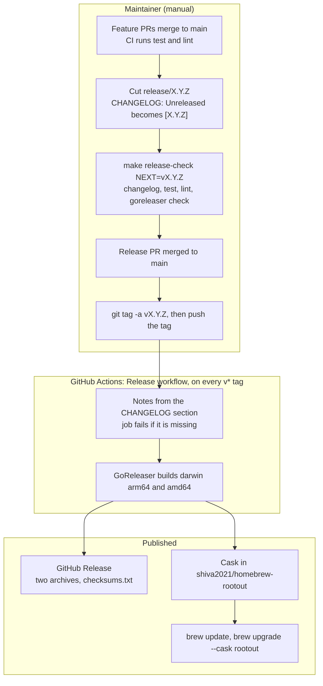

# rootout

Uninstall macOS apps completely, and find risky extensions in VS Code, Cursor,
VSCodium, Windsurf and VS Code Insiders.

```bash
rootout                       # home screen: uninstall an app, remove orphans, scan extensions, assess apps
rootout list [--search q]     # installed apps
rootout remove <app> -n       # dry run: show the bundle and every leftover file
rootout remove <app>          # move them to the Trash after you confirm
rootout scan                  # score installed extensions; review and uninstall on a terminal
rootout scan --llm            # also ask Claude, OpenAI or a local Ollama model
rootout assess                # every app with its signature and origin; ask the AI what to keep
rootout assess <app>          # one app: is the source legitimate, what is it for, keep or drop
rootout orphans               # leftovers of apps you already deleted, grouped by old app id
rootout setup                 # optional: a local model or a Claude/OpenAI key for recommendations
rootout config models --pick  # choose or download a local model that fits this Mac
rootout doctor                # check what rootout depends on
rootout guide                 # a step-by-step tour adapted to this Mac
```

## Install

```bash
# Homebrew
brew tap shiva2021/rootout
brew trust shiva2021/rootout   # Homebrew 7 asks this once for third-party casks
brew install --cask rootout

# Go toolchain (`rootout --version` prints `dev` this way; no release metadata)
go install github.com/shiva2021/rootout/cmd/rootout@latest

# Direct download: grab rootout_<version>_darwin_<arch>.tar.gz from the Releases page, then
tar xzf rootout_*_darwin_*.tar.gz && xattr -d com.apple.quarantine rootout && mv rootout ~/.local/bin/

# From source
make install
```

The binary is not code-signed; Homebrew clears the quarantine flag for you.

rootout tells you when a newer release exists: `rootout doctor` checks
GitHub and prints the upgrade command, and the home screen shows a one-line
notice after the version, looked up at most once a day.
`rootout config set updates.check false` turns both off.

## First launch

The first `rootout` opens a short setup screen: pick a free local model
through Ollama, paste a Claude or OpenAI API key (checked with one free
request, then stored in the macOS Keychain, after which you pick the model
the key may use), or choose "Not now". AI is optional: without it, scans
still score extensions with the built-in rules; with it, tick extensions in
the scan screen and press `l` to ask the model whether to keep or uninstall
them (two at a time; the right pane lists every answer). The home
screen always shows the current AI status and model, and `rootout setup`
reopens the screen.

The same model can look at installed apps. `rootout assess` lists every app
and, as the cursor rests on one, gathers its facts locally: who signed it
(Team ID), whether Gatekeeper accepts it, where it was downloaded from, the
App Store receipt, launch agents and the permissions it declares. Tick apps
and press `l` to ask the model what each app is for, whether its source is
legitimate, how confident it is and whether to keep or drop it; `rootout
assess <app>` does one app from the command line, and `ctrl+l` in the
uninstall picker asks about the highlighted app before you decide. The answer is advice: a
ticked app still gets the usual review of its files before anything moves to
the Trash. Answers from Claude and OpenAI are saved and reused.

Nothing is uninstalled until you type `delete`. In every screen `?` lists the
keys; in the scan screen `m` changes the model without leaving the scan (the
provider's hosted list, or the local Ollama picker). Scripts use
`rootout config models --provider anthropic|openai [--pick]`.
esc goes back one screen; ctrl+x quits from anywhere.

Every command takes `--json`. Removal goes to the Trash unless `--permanent`.
System apps are listed but never removable. Nothing runs as root; files that
need admin rights are removed in one step after a single macOS password prompt.

Extension scanning is static: extension code is never executed. Scores separate
what an extension can do (spawn processes, eval) from evidence of intent
(hidden payloads, credential reads, exfiltration hosts); see
`docs/kb/heuristics.md`. An AI model, if configured, sees only the findings and
short snippets, never the whole extension.

## Contributing

Issues and pull requests are welcome. Branch from `main`, keep `make test` and
`make lint` green, and read `CLAUDE.md` and `docs/kb/README.md` first: every
deletion goes through `internal/safety.Validate`, and no test may touch the
real home directory. Security reports: see `SECURITY.md`.

## Releases

Pushing a `v*` tag publishes rootout. The maintainer steps are manual up to the
tag; everything after it is the `Release` workflow. The full runbook is in
`docs/kb/release.md`.



The `Release` job runs no tests, so `make release-check` before tagging is the
gate (D-032).

## Licence

MIT, see `LICENSE`.
